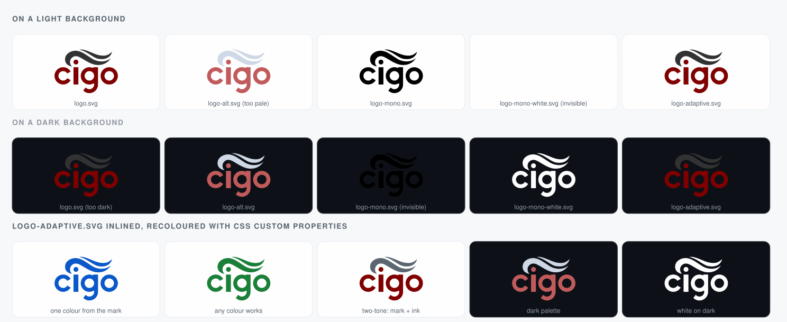

# Logo assets

Every file shares one geometry, cropped from the original 600x600 Inkscape
canvas to its bounding box so the mark stays readable at small sizes. The six
logo files differ only in colour; the preview files exist to show that.

| File | Use |
|---|---|
| `logo.svg` | Default. Light backgrounds: README, docs, web pages, print on white. |
| `logo-alt.svg` | Dark backgrounds. Lighter brick and near-white ink; washed out on white. |
| `logo-mono.svg` | One flat black, for stamps, watermarks and single-colour printing. |
| `logo-mono-white.svg` | One flat white, for dark backgrounds, photographs and overlays. |
| `logo-adaptive.svg` | Colourable from CSS. Looks like the default when referenced as an image. |
| `logo-master.svg` | The 600x600 Inkscape source. Edit this, then regenerate the rest. |
| `logo-preview.svg` | Contact sheet with every variant on light and dark backgrounds. |
| `logo-preview.png` | The same sheet rasterised, for READMEs and slide decks. |

Colours: brick `#800000` and ink `#333333` in the default; `#c25b5b` and
`#cfd8e6` in the dark variant.

## The adaptive variant

CSS cannot reach inside an image, so custom properties only work when the SVG
is inlined into the HTML document:

```html
<svg xmlns="http://www.w3.org/2000/svg" viewBox="8 30 142 99"
     style="--cigo-mark: #0a58ca">
  <!-- contents of logo-adaptive.svg -->
</svg>
```

- `--cigo-mark` sets the brick part and defaults to `#800000`.
- `--cigo-ink` sets the smoke above the lettering only; it falls back to
  `--cigo-mark` and then to `#333333`, so setting only the mark yields a
  one-colour logo. The lettering, including the dot over the i, always follows
  `--cigo-mark`.

Referenced as an image (``) the file keeps its
default colours, which makes it a safe drop-in replacement for `logo.svg`.

## Regenerating the preview

`logo-preview.svg` is generated from the artwork above; the PNG is rendered
from it. After editing `logo-master.svg`, redraw both:

```bash
inkscape assets/logo/logo-preview.svg --export-type=png \
  --export-filename=assets/logo/logo-preview.png --export-width=1488
convert assets/logo/logo-preview.png -strip -depth 8 -colors 256 PNG8:assets/logo/logo-preview.png
```

The second command only keeps the file small; it is optional.

## Preview


